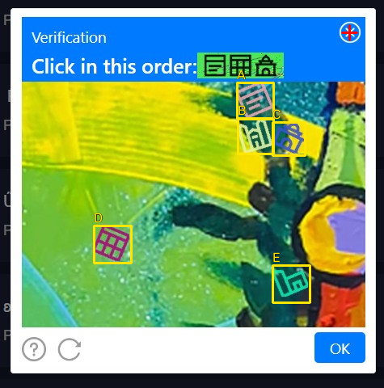
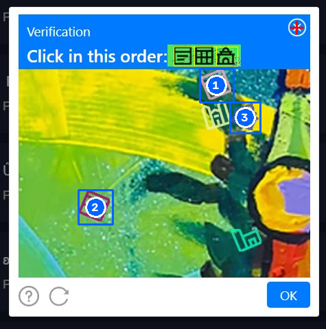

# Midasbuy CAPTCHA tools

Local screenshot collection, image analysis and reviewed single-attempt browser solving for two CAPTCHA formats. Capture and solving use separate Chrome / Edge extensions.

**Project release: v1.2.0** · [Changelog](CHANGELOG.md) · [GitHub releases](https://github.com/safin1337/midasbuy-captcha/releases)

| Component | Current state |
| --- | --- |
| Capture extension | v1.0.7, unchanged; `captcha-data-extraction/dist` |
| Solver extension | Separate **Midasbuy Captcha Solver** v1.1.0; `Midasbuy Captcha Solver/dist` |
| Format B matcher | v1.1.0; five-candidate localization and three selections in prompt order |
| Format A | Experimental outline detector and three-stage drag with live DOM position feedback; trial logging |

Project and component versions are separate. v1.2.0 adds solver extension v1.1.0;
capture extension v1.0.7 and Format B matcher v1.1.0 remain unchanged.

See [solver setup](<Midasbuy Captcha Solver/README.md>) and the
[v1.2.0 release notes](docs/releases/v1.2.0.md).
Saved-image and local browser-control checks pass. Live provider acceptance remains
unverified, and Format A's initial image recognition remains experimental.

## Format B example

Format B asks you to select **three symbols in order** from the **five symbols** in the larger picture. The references appear beside **Click in this order**. The scene symbols can have different colors and rotations.

**Original CAPTCHA**


**Detected candidates**

The matcher labels the five scene symbols **A, B, C, D, and E** before comparing them with the references.



**Proposed selection: `A -> D -> C`**

For this saved example, the matcher proposes **A first, D second, and C third**. The numbered annotation below shows that order. This is the saved model proposal, not a website-verified result. See the [example JSON report](Format_B/diagnostics/dot_evaluation/input/result.json).



The project's matcher produces a numbered preview and a JSON report for this format. Uncertain proposals stay marked for review; it does not click the symbols or submit an answer. See [Analyze a Format B image](#analyze-a-format-b-image) to try it on a saved screenshot.

## Collect screenshots

Python and Node.js are not needed to use the bundled extension.

1. Download and extract this repository, or clone it:
   ```powershell
   git clone https://github.com/safin1337/midasbuy-captcha.git
   cd midasbuy-captcha
   ```
2. Open `chrome://extensions` or `edge://extensions` and enable **Developer mode**.
3. Click **Load unpacked** and select `captcha-data-extraction/dist`.
4. Open the CAPTCHA tab, click the extension icon, and choose **Format A (Slider)** or **Format B (selector)**.
5. Choose the **final destination folder**, such as `D:\Projects\midasbuy-captcha\Format_B\raw_data`. Photos save directly there, without extra subfolders. Each format remembers its own folder.
6. Mark the capture rectangle, then mark the reload button inside it.
7. Click **Start 10 captures**. Keep the CAPTCHA visible and the controls open. **Stop** or **Escape** interrupts the run.

The destination appears as `Currently Selected: [Hidden by Chrome]\midasbuy-captcha\Format_B\raw_data` when the extension knows that relative suffix. Otherwise, only the selected folder name appears after the hidden-path prefix. Ancestors are never guessed.

Each run saves up to ten new `inputN.png` files, continues the highest existing number, and skips filename collisions. Reload cycles target five seconds, with a random capture threshold one to three seconds after each reload and image-readiness checks. Slow loading extends the cycle.

The capture engine takes a visible-viewport screenshot and crops it in memory to avoid browser-level clipped captures suspected of causing embedded-frame flashing. Live elimination of that flash has not been confirmed.

See the [extension guide](captcha-data-extraction/README.md) for permissions, upgrades, timing, and troubleshooting. After updating the build, close the controls and reload the extension on the extensions page.

## Analyze a Format B image

The default matcher finds five physical symbols, compares the three prompt shapes using rotation-aware contour points and family evidence, and proposes three distinct targets in order. Weak matches retain review flags.

On Windows PowerShell, from the repository root, create the shared Python environment once:

```powershell
python -m venv .venv
.\.venv\Scripts\python.exe -m pip install -r requirements.txt
```

Use Python 3.12 or later. Save a full verification-dialog screenshot, including its close button, in `Format_B/raw_data`, then run:

```powershell
.\detect.ps1 -Image .\Format_B\raw_data\input.png
```

Inspect `Format_B/output/annotated.png`, `dot-gallery.png`, `dot-alignment.png`, and `result.json`. The JSON includes proposed candidate IDs, coordinates, scores, alternatives, mask recovery, and review reasons.

Other modes:

```powershell
# Locate five symbols without matching prompt order.
.\detect.ps1 -Image .\Format_B\raw_data\input.png -CandidatesOnly

# Use the previous matcher.
.\detect.ps1 -Image .\Format_B\raw_data\input.png -LegacyMatcher
```

See the [Format B guide](Format_B/README.md) for coordinate conventions, evaluation, and diagnostic outputs.

## Reviewed inputs 26-46

The user confirmed **63/63 ordered target proposals across 21 captures** (20 unique images; inputs36 and39 are identical). Runtime review flags remain on 18 targets across 13 images. See the [complete reviewed results](Format_B/diagnostics/dot_evaluation/batch_26_46_user_review.md).

**Known localization defect:** input46 selects the correct A -> C -> E targets, but candidate D is background texture and the gray document on the left is missed. The [RCA](Format_B/diagnostics/review_44_46/input46_rca.md) includes ranking evidence and improvement criteria. The defect is documented, not fixed in v1.1.3.

These are reviewed saved proposals, not independent production accuracy or website-verified outcomes. The earlier v1.1.3 release retained matcher v1.1.0 and capture extension v1.0.7 without adding submission, retries, or threshold changes. The separate solver introduced in v1.2.0 is described above. User confirmation of examples does not automatically clear runtime uncertainty flags.

## Validation and limits

- The v1.1.0 matcher validation records **75/75 correct target proposals on 25 reviewed development images**, with candidate boxes and previously confident selections unchanged. These images were used during development; this is not unseen production accuracy. The input19 recovery still requires review.
- Extension v1.0.7 passed 15 unit tests, a ten-image local Chromium run with a cross-origin iframe and 125% display scale, folder persistence and direct-save checks, and rendering checks at 390, 460, 1440, and 1728 pixels.
- The native folder-selection dialog and live Midasbuy compatibility remain unverified. Browser integration uses local fixtures and a stubbed picker with real directory handles.
- Recognition scores are uncalibrated. Pixel stability cannot distinguish a valid challenge from a provider error graphic. Inspect the preview and review flags.
- Offline analysis does not send input. The separate solver extension's explicit **Solve once** action sends the proposed clicks and OK for Format B, or one held three-stage drag for Format A. Capture runs still only reload and save screenshots.

Detailed evidence: [matcher validation](Format_B/diagnostics/v1.1.0-validation.json) and [extension verification](captcha-data-extraction/VALIDATION.md).

## Development checks

From the repository root:

```powershell
.\.venv\Scripts\python.exe .\Format_B\test_detector.py
.\.venv\Scripts\python.exe .\Format_B\test_anchor.py
.\.venv\Scripts\python.exe .\Format_B\test_input19_regression.py
```

For extension development, install Node.js and npm:

```powershell
cd captcha-data-extraction
npm.cmd ci
npm.cmd test
npm.cmd run build
```

The optional `tests/browser.cjs`, `tests/visual.cjs`, and root `inspect-midasbuy.cjs` currently reference Playwright from the adjacent SoulShopBD checkout. Adjust that local dependency before using them elsewhere. The inspection script contacts Midasbuy and submits a supplied player ID to reproduce a verification prompt; normal build and unit-test commands do not require it.

## Repository layout

```text
Format_A/                 Slider samples and collection data
Format_B/                 Symbol matcher, datasets, examples, and diagnostics
Midasbuy Captcha Solver/   Independent solver extension, local engine, and trials
docs/releases/            Release notes and validation
captcha-data-extraction/   Extension source, tests, and loadable dist build
experiments/              Development experiments and comparison results
inspection/               Browser-inspection evidence
detect.ps1                Root launcher forwarding to Format_B
requirements.txt          Shared Python dependencies
VERSION                   Current project release
CHANGELOG.md              Project and component change history
```

Dependencies, virtual environments, caches, generated `output/` directories, and extension browser profiles are excluded from Git. Reviewed datasets and diagnostic reports are included.
